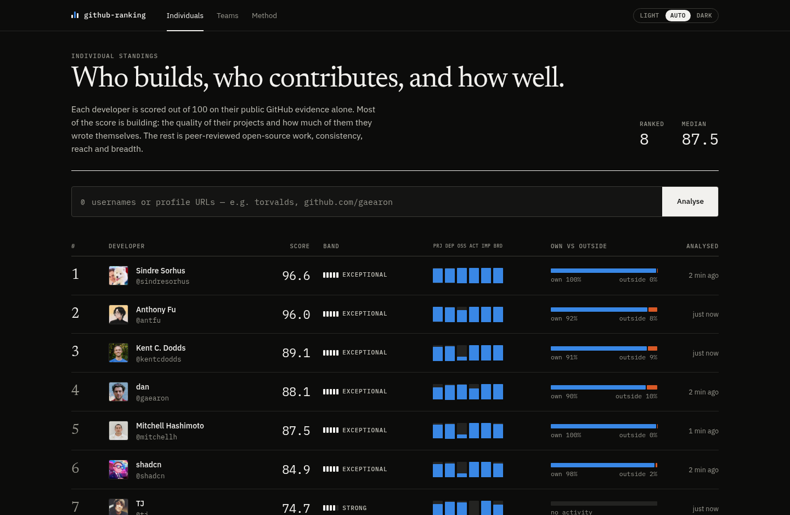
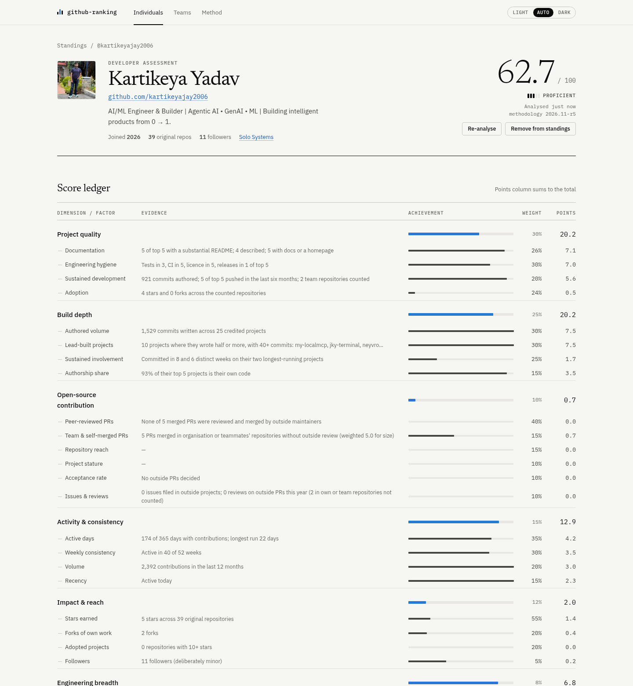
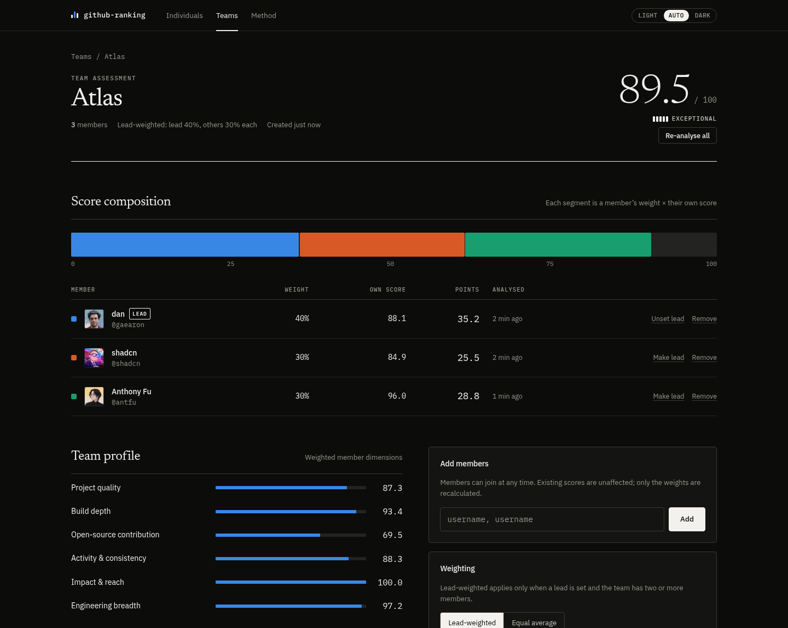
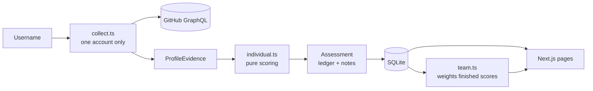

# github-ranking

**Evidence-based assessment and ranking of GitHub developers and teams.**

Paste a username and get a score out of 100. Every point traces back to public GitHub evidence and a fixed, published rule. The score measures what the person **built themselves**: how good their projects are, how much of them they wrote, and what other maintainers accepted from them. Stars, followers and commit counts can be inflated, so they matter much less.



<table>
  <tr>
    <td width="50%"></td>
    <td width="50%"></td>
  </tr>
  <tr>
    <td align="center"><sub>Profile: every factor, its evidence and the points it earned</sub></td>
    <td align="center"><sub>Team: each member's weight × their own score</sub></td>
  </tr>
</table>

---

## Contents

- [Why](#why)
- [How a score is built](#how-a-score-is-built)
- [What counts as whose work](#what-counts-as-whose-work)
- [Teams](#teams)
- [Fairness guarantees](#fairness-guarantees)
- [Quick start](#quick-start)
- [Configuration](#configuration)
- [Deployment](#deployment)
- [Capacity](#capacity)
- [Architecture](#architecture)
- [Development](#development)
- [Limitations](#limitations)
- [Roadmap](#roadmap)

---

## Why

The usual ways of judging a GitHub profile are easy to game:

| Common signal | How it gets inflated |
|---|---|
| Green squares, commit count | Many tiny commits; backdated commits |
| "Contributed to N repos" | PRs to your own organisation, self-merged PRs, Hacktoberfest "add your name" repos |
| Followers | Follow-for-follow |
| Number of repositories | Dozens of tutorial or empty repositories |

**github-ranking** reads what each person demonstrably built and what outside maintainers chose to accept. It then reports the result as a ledger: each factor, its evidence, its weight and its points, adding up to the total.

---

## How a score is built

Six dimensions, each scored 0–100 and weighted into a total. **55% of the score is building.**

| Dimension | Weight | Question it answers |
|---|---:|---|
| **Project quality** | 30% | Are their best projects well-engineered, documented, maintained and used? |
| **Build depth** | 25% | How much of those projects did *they* write, and how long did they stay with them? |
| **Activity & consistency** | 15% | Have they been working steadily over the last 12 months? |
| **Impact & reach** | 12% | Do other people use their work? |
| **Open-source contribution** | 10% | Has code they wrote been accepted into other people's projects? |
| **Engineering breadth** | 8% | Range of languages, substantial projects and collaborations |

**Bands:** Exceptional 80+ · Strong 65–80 · Proficient 50–65 · Developing 35–50 · Emerging below 35.

Every count passes through a **saturating log curve** with a fixed target. Early progress counts a lot, later progress less, and nothing exceeds 100%. Example (stars, target 1,000):

| Stars | 0 | 10 | 100 | 1,000+ |
|---|---:|---:|---:|---:|
| Achievement | 0% | 35% | 67% | 100% |

<details>
<summary><b>Project quality (30%)</b>: the five best repositories, weighted 35 / 25 / 18 / 12 / 10%</summary>

Up to 24 owned repositories and 8 team repositories are inspected in depth. Each scores out of 100:

| Group | Points | Signals |
|---|---:|---|
| Documentation | 26 | README size (14, square-root curve to 4 KB), description (4), topics (2), homepage (3), docs folder or site generator (3) |
| Engineering hygiene | 30 | Test suite (10), CI configuration (9), licence (7), published releases (4) |
| Sustained development | 20 | Commits the person authored (14, log curve to 200), pushed within six months (6) |
| Adoption | 24 | Stars (18, log curve to 1,000), forks (6, log curve to 150) |

Each repository's score is then multiplied by an **authorship factor**, `min(1, 0.4 + 1.2 × share)`, where *share* is the fraction of default-branch commits the person wrote. Writing half or more earns full credit; writing a quarter earns 70%. Forks and the profile-README repository are excluded.
</details>

<details>
<summary><b>Build depth (25%)</b>: how much of their projects the person personally wrote</summary>

| Factor | Share | Measure |
|---|---:|---|
| Authored volume | 30% | Commits written across credited projects; log curve to 1,500 |
| Lead-built projects | 30% | Projects where they wrote ≥ 50% of commits, with 40+ commits; full at 5 |
| Sustained involvement | 25% | Distinct weeks with commits on their two longest-running projects (up to 500 commits read on the three busiest); full at 26 weeks |
| Authorship share | 15% | Portfolio-weighted share of their top five projects that is their own code |
</details>

<details>
<summary><b>Open-source contribution (10%)</b>: peer-reviewed work counts most</summary>

| Factor | Share | Measure |
|---|---:|---|
| Peer-reviewed PRs | 40% | Merged by an outside maintainer. Each is weighted by project stature (0.4 → 1.0 at 2,000★) × size of change (0.35 → 1.0 at 150 lines); log curve to 40 |
| Team & self-merged PRs | 15% | PRs in organisation or teammates' repositories, weighted by size; log curve to 60 |
| Repository reach | 15% | Distinct outside repositories that accepted their work; log curve to 15 |
| Project stature | 10% | Stars of the most prominent repository they landed a PR in; log curve to 20,000 |
| Acceptance rate | 10% | Outside merged ÷ decided, smoothed and discounted below ten PRs |
| Issues & reviews | 10% | In outside projects only; log curve to 60 |
</details>

<details>
<summary><b>Activity (15%), impact (12%), breadth (8%)</b></summary>

**Activity & consistency** (last 12 months): active days (35%, full at 220), weeks with activity (30%, out of 52), contribution volume (20%, log curve to 1,500), recency (15%, full within 14 days, zero at 180).

**Impact & reach:** stars earned (55%, log curve to 5,000), forks (20%, log curve to 500), repositories with 10+ stars (20%, log curve to 10), followers (**5%**, log curve to 1,000; deliberately minor).

**Engineering breadth:** distinct languages (40%, full at 8), repositories scoring 45+ on quality (35%, full at 8), repositories contributed to this year (25%, full at 25).
</details>

The full specification also lives in the app at **`/method`**.

---

## What counts as whose work

Every merged pull request in a repository the person doesn't own is classified using GitHub's own author association and who merged it:

| Class | Rule | Where it's credited |
|---|---|---|
| **Outside** | Author is not an owner, member or collaborator, and someone else merged it | Open source, in full |
| **Team** | Author is a member or collaborator there, or merged their own PR | Smaller open-source factor; the repository counts under project quality and build depth, scaled by authorship |
| **Farm** | Repository exists to collect easy PRs (Hacktoberfest, first-contributions, contribution walls, question dumps) | 15% of an outside PR |

The same rule applies to issues and reviews: activity inside the person's own organisations doesn't count as outside engagement.

Each profile also splits the last 12 months into **own & team work** vs **outside contribution** and labels the person:

- **Builder-led:** at most 25% outside.
- **Contributor-led:** 60% or more outside.
- **Balanced:** anything in between.

The split describes how someone works; it doesn't add or remove points by itself.

---

## Teams

A team's score is the weighted mean of its members' **finished, independent** scores.

| Members | Lead-weighted (default) | Equal average |
|---:|---|---|
| 1 | 100% | 100% |
| 2 | 60 / 40 | 50 / 50 |
| 3 | 40 / 30 / 30 | 33.3 each |
| 4 | 30 / 23.3 / 23.3 / 23.3 | 25 each |
| 5 | 24 / 19 × 4 | 20 each |

The lead carries 1.2× an equal share (`1.2 / n`). Without a designated lead, a team uses the equal average. Members can be added at any time, from the team page or by creating a team with the same name again. Adding a member re-weights the team and never changes anyone's own score.

---

## Fairness guarantees

- **One person, one context.** An assessment reads a single account's data. No other participant is consulted, compared or used for normalisation.
- **Absolute thresholds.** Adding, removing or re-analysing anyone never moves another person's score; rankings are a plain sort.
- **Deterministic.** The same evidence always produces the same score. The scoring functions are pure and unit-tested.
- **Traceable.** Every profile shows the evidence behind each factor and notes anything that couldn't be measured, such as private contributions or very large histories.
- **Versioned.** Each assessment records its methodology version (currently `2026.11-r5`). Changing the rules bumps the version, and older snapshots are re-crawled the next time they're requested.

---

## Quick start

Requires **Node.js 22.13+**. Storage uses the built-in `node:sqlite`, so there are no native dependencies.

```bash
git clone https://github.com/kartikeyajay2006/github-ranking.git
cd github-ranking
npm install
cp .env.example .env    # add GITHUB_TOKEN, or skip if you're signed in with `gh`
npm run dev             # http://localhost:3000
```

Production:

```bash
npm run build
npm start
```

## Configuration

| Variable | Default | Purpose |
|---|---|---|
| `GITHUB_TOKEN` | output of `gh auth token` | Token for GitHub's GraphQL API. Only public data is read, so a fine-grained token with no extra permissions is enough. |
| `DATABASE_PATH` | `data/ranking.db` | SQLite file holding analyses, standings and teams |
| `ANALYSIS_TTL_HOURS` | `12` | How long a stored analysis is reused before a fresh crawl |

---

## Deployment

The app keeps state in a SQLite file, so it needs **persistent disk**. A VM, a container with a volume, or any long-running Node host works.

> **Serverless platforms such as Vercel are not supported as-is.** Their file systems are ephemeral, so the database would be lost. Running there needs a hosted database (for example Postgres) behind `src/lib/store.ts`.

Anyone who can reach the app can add, remove and edit entries. Put it behind your own access control (VPN, reverse-proxy auth) before exposing it publicly.

---

## Capacity

Measured against GitHub's GraphQL API:

| | Measured |
|---|---|
| Time to analyse | ~8 s for a typical account; up to ~35 s for very prolific ones |
| API cost | ~11 points per account on average |

- **Rate limit:** GitHub allows 5,000 points per hour per token, roughly **400 typical accounts per hour**. GitHub's terms don't allow pooling several accounts' tokens to get around this.
- **Concurrency:** requests go through a gate of 4 in flight, secondary rate limits are retried with back-off, and very large repositories are isolated so they can't stall a batch.
- **Storage:** about 50–80 KB per analysed person.

---

## Architecture



```
src/
├─ lib/
│  ├─ github/client.ts       GraphQL client: token resolution, request gate, back-off, timeouts
│  ├─ github/collect.ts      Evidence for ONE login: profile, contributions, repository scan,
│  │                         deep inspection, team-repo discovery, PR/issue classification inputs
│  ├─ scoring/curves.ts      Saturating curves and helpers
│  ├─ scoring/individual.ts  Pure, deterministic scoring and the score ledger
│  ├─ scoring/team.ts        Team weights and weighted aggregation
│  ├─ analyze.ts             Collect → score → store, with freshness cache and de-duplication
│  └─ store.ts, db.ts        SQLite persistence
├─ app/                      Next.js App Router pages and server actions
└─ components/               UI: standings, ledger, heatmap, forms, theme toggle
```

**Stack:** Next.js 16 (App Router, server actions), React 19, TypeScript, `node:sqlite`, Vitest. No UI framework or chart library; the visual system is a single stylesheet with light and dark themes and a colour-blind-safe palette.

---

## Development

| Command | What it does |
|---|---|
| `npm run dev` | Development server |
| `npm test` | Unit tests for scoring, classification, authorship, team weights and parsing (no network) |
| `npm run typecheck` | TypeScript |
| `CALIBRATE=user1,user2 npm run calibrate` | Live run against real accounts; writes scores to `calibration.txt` |

When changing weights or rules, edit `src/lib/scoring/individual.ts`, bump `METHODOLOGY_VERSION`, update `/method`, and calibrate against a spread of real accounts (new, student, established, prolific) before shipping.

---

## Limitations

- **Public data only.** Private contributions appear in the activity calendar when the user has enabled it, but can't be inspected.
- **Team repositories** are found through merged PRs and the last 12 months of commits. An old organisation project with no recent activity isn't picked up.
- **Contribution farms** are recognised by repository name.
- **Tests** are detected at the repository root and in `src/test`. Tests nested deeper in a monorepo can be missed.
- **Commits from an e-mail not linked to the account** don't attribute to it. On repositories the person owns, half of the history is credited and the profile says so.
- **Very large histories:** the 200 most recent merged PRs are classified and the rest are assumed to follow the same mix. Commit dates are read up to 500 per project.
- **One account per person.** Work split across two GitHub accounts is assessed separately.

## Roadmap

- Bulk import of teams from CSV, with a resumable background queue for thousands of applicants
- A pinned evaluation cut-off date so long batch runs measure everyone over the same window
- Postgres storage adapter for serverless hosting
- Admin authentication
- CSV export of standings and selection lists
