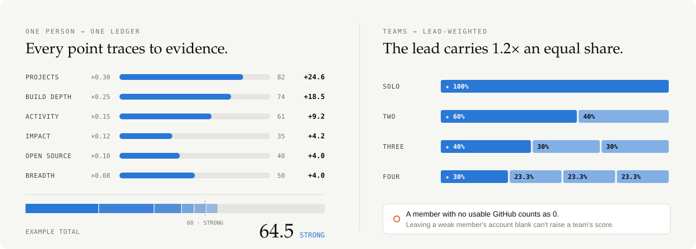

<picture>
  <source media="(prefers-color-scheme: dark)" srcset="docs/assets/brand/hero-dark.svg">
  
</picture>

<a href="mailto:kartikeya2006jay@gmail.com?subject=github-ranking%20access">
<picture>
  <source media="(prefers-color-scheme: dark)" srcset="docs/assets/brand/access-dark.svg">
  
</picture>
</a>

> [!NOTE]
> **There is no public link.** The live instance ranks real applicants, so it stays private.
> For a demo, access, or your own instance, email **[kartikeya2006jay@gmail.com](mailto:kartikeya2006jay@gmail.com?subject=github-ranking%20access)**.

**github-ranking** scores developers and teams out of 100 on what they **built themselves**: how good their projects are, how much of them they wrote, and the open-source work that *other* maintainers accepted. Stars, followers and green squares barely count. Every point traces back to public evidence and a fixed rule.

## What it does

| Feature | What you get |
|---|---|
| **Individuals** | Paste usernames or profile links and get a 0–100 score with a ledger of every factor. |
| **Teams** | The lead carries 1.2× an equal share (40/30/30 for three; a solo team is 100%). Members can be added any time. Search by team, lead or member, several at once separated by commas; the same people are never listed as two teams. |
| **Upload** | Drop a PDF, Word, Excel or CSV file, a Google Docs/Sheets link (any tab), or pasted text. Teams, leads, members, emails, GitHub accounts, statuses and best-project links are pulled out automatically. Importing the same sheet again replaces the earlier import once the re-run finishes, so no team appears twice. |
| **Best project** | Each person's named repository is graded on its own (substance, engineering, completeness, recognition × how much of it they wrote) and blended with their profile, 70/30 by default. Re-weight any time, instantly. |
| **Messy data** | Same-named teams kept apart and labelled by their lead, re-registrations merged, people in two teams flagged, withdrawn entries left out. |
| **Live ranking** | Thousands of teams rank in the background, appearing one by one. Survives restarts and waits out GitHub rate limits. |
| **Selection** | Set a top-N cut-off (e.g. 800 of 5,000), search, and export CSV. |
| **Data safety** | Verified hourly snapshots, automatic repair from the last good copy, password-protected access. |

<picture>
  <source media="(prefers-color-scheme: dark)" srcset="docs/assets/brand/how-dark.svg">
  
</picture>

## Bands

| Exceptional | Strong | Proficient | Developing | Emerging | Insufficient |
|:---:|:---:|:---:|:---:|:---:|:---:|
| **75+** | **60–75** | **50–60** | **35–50** | **12–35** | **< 12** · never selected |

## Run your own

```bash
git clone https://github.com/kartikeyajay2006/github-ranking.git && cd github-ranking
npm install && npm run build
GITHUB_TOKEN=<token> ADMIN_PASSWORD=<password> npm start    # http://localhost:3000
```

Needs Node.js 22.13+. No external database: storage is the built-in `node:sqlite`.

**[Open the documentation hub →](docs/README.md)** for the full guide, repository map, scoring method, upload formats, data safety, deployment and architecture.

<sub>Next.js 16 · React 19 · TypeScript · SQLite · GitHub GraphQL · 105 tests</sub>

---

<div align="center">

**Need this for your hackathon, cohort or hiring round?**<br>
[kartikeya2006jay@gmail.com](mailto:kartikeya2006jay@gmail.com?subject=github-ranking%20access)

</div>
